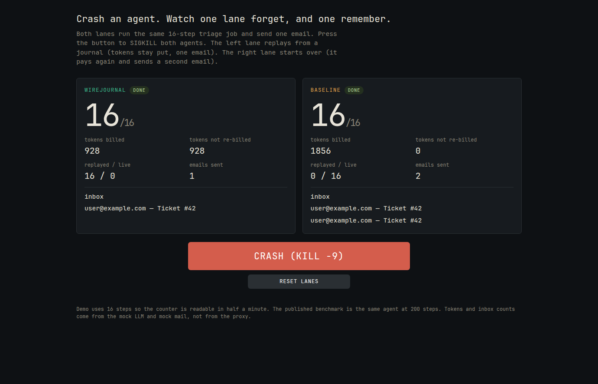
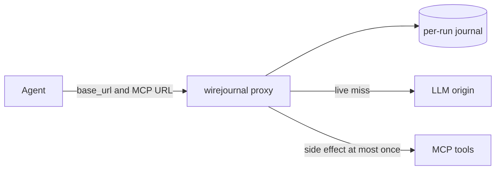

# wirejournal

A drop-in proxy that journals an agent's LLM and MCP calls. After `kill -9`, the next process replays finished work from disk. It does not re-bill those model calls and it does not send the email again.

**Measured, 30 interleaved `kill -9` trials, 200-step agent.** Ground truth is the mock LLM billing ledger and the mock mail delivery counter, not the proxy's own `/status`. Method and raw trials are in [`docs/bench.md`](docs/bench.md).

| arm | resume to the crash point | extra model calls | extra tokens | emails delivered |
|---|---|---|---|---|
| wirejournal | **233 ms** (20-454) | **0** (max 0) | **0** | **1** (max 1) |
| baseline | 132 ms (7-290) | **145** (max 199) | 45820 (max 84376) | 1 (max **2**; 2/30 trials sent a second email) |

Baseline "resume" is a full re-run of the prefix, so it can use less CPU time than journal replay. The product claim is zero re-billing and at-most-once mail.

The 16-step live demo on this host, crashed after `send_email`: wirejournal finished at **928 tokens billed, 1 email**. Baseline finished at **1856 tokens billed, 2 emails**. Replay of the journaled prefix completed inside the 500 ms snapshot after the crash.



[Animated capture of the same crash](docs/img/demo.gif)

## Quick start

```bash
go build -o wirejournal ./cmd/wirejournal
./wirejournal demo
```

Open `http://127.0.0.1:8080` and press **Crash (kill -9)**.

## Point an existing agent at it

```bash
./wirejournal proxy -listen 127.0.0.1:7070 -data ./wj-data \
  -llm-upstream https://api.openai.com \
  -mcp-upstream http://127.0.0.1:9200
export OPENAI_BASE_URL=http://127.0.0.1:7070/r/job-42/v1
export MCP_URL=http://127.0.0.1:7070/r/job-42/mcp
```

The agent code does not change. A fresh attempt id is optional and exact: `/r/job-42/a/$ATTEMPT/v1`.

## How it fits



Each request is canonicalized and identified as `(kind, sha256(canonical body), k)`. `Run.Do` owns every commit. Adapters never write the journal. A streamed chat completion is teed to the client, fsynced, then closed with `data: [DONE]`. A side-effecting tool writes an `Intent` before dispatch and a `Committed` record after. On resume, a committed call is replayed. An intent without a commit is the ambiguous window: if the tool honors keys, the same `wj1-` key is sent again; otherwise the run fails closed and is quarantined.

Design rationale: [`docs/design.md`](docs/design.md).

## Why Go

The proxy needs an HTTP server, an HTTPS client, SSE flush, JSON, CRC32C, `flock`, and `os/exec` for real `SIGKILL`s. Go's standard library has all of them, so v0 has no third-party module. A Rust build without crates would need a hand-written TLS client. One static binary carries `proxy`, `mockllm`, `mockmail`, `agent`, `bench`, and `demo`.

## What it is not

| nearby tool | what it does | what wirejournal does instead |
|---|---|---|
| [Peashoot](https://github.com/Chang-Chia-Chi/Peashoot) | LLM record/replay and stream resume | Adds an MCP side-effect journal with annotation-driven policy, plus a crash-resume bench whose numbers come from mock ledgers |
| Restate, Temporal, DBOS | Durable execution with an SDK | Zero code change at the network boundary. The trade-off is that the agent must be deterministic up to the crash point |
| LangGraph checkpointers, Agents SDK durable integrations | Framework-native checkpoints | Same agent loop, any language, as long as it speaks OpenAI chat completions and MCP HTTP |

Peashoot's README is about replay cost and observability, not side-effect safety. Restate is the heavier, better tool if you can adopt its programming model. This proxy will not make a nondeterministic agent crash-safe.

## Limits

- Nondeterministic prompts (wall-clock timestamps, random ids, `temperature > 0` that changes later requests) cause early divergence. The proxy reports the first differing JSON pointer and goes live. It does not rewrite the agent.
- Journals hold prompts in plaintext. `Authorization` is forwarded and never written.
- The ambiguous crash window cannot be solved in general. v0 either redispatches with a stable idempotency key or fails closed. There is no `resolve` command. Start a new run.
- Rule 3 (agent-only restart with a static base URL) can suppress a deliberate repeat of the very first model request. It will not duplicate a side effect. Use an attempt id when that matters.
- Replay is not timing-faithful. Anthropic Messages, OpenAI Responses, MCP stdio, compaction, encryption, and replication are not in v0.
- The live demo kills the **agent** children. The in-process proxy stays up, which matches an agent-only OOM. The published bench also kills the proxy process.

## Reproduce the bench

```bash
go build -o wirejournal ./cmd/wirejournal
./wirejournal bench -n 30 -steps 200 -out docs/bench.json
```

`go test -race ./...` includes the crash-recovery integration tests. `go test -short ./...` skips the `SIGKILL` cases.

## Render

[`render.yaml`](render.yaml) is a free-tier web service: `go build -o wirejournal ./cmd/wirejournal`, then `./wirejournal demo`. It binds `0.0.0.0:$PORT`, checks `/healthz`, and sets `WJ_STEPS=16`. Plan: 512 MB, 0.1 CPU.

MIT. See [`LICENSE`](LICENSE).
